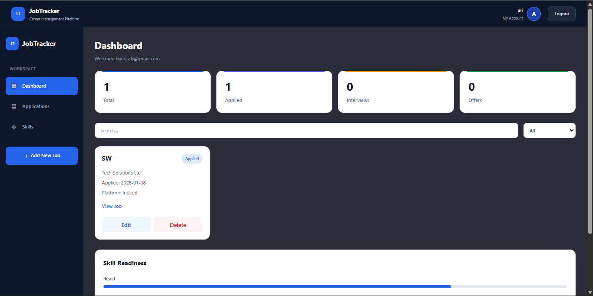
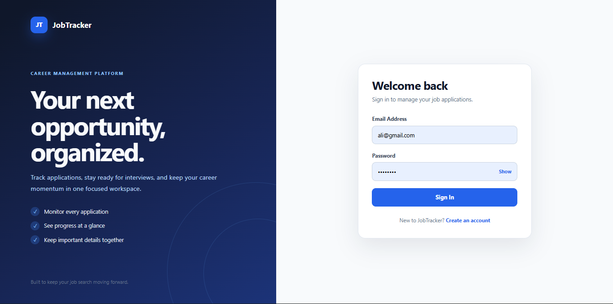
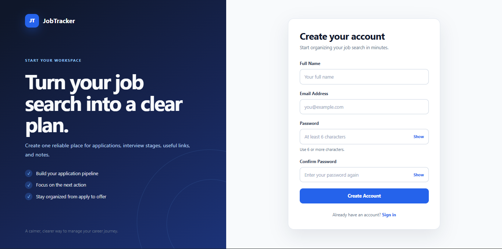
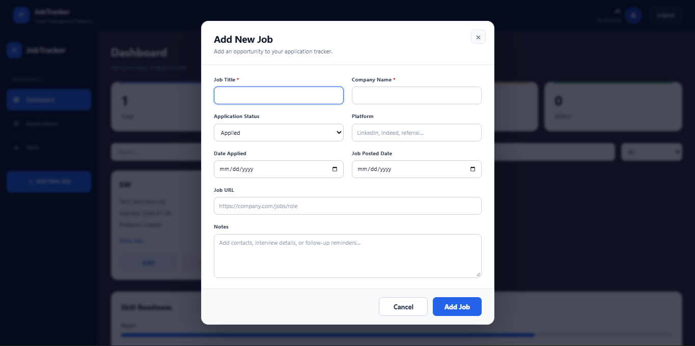
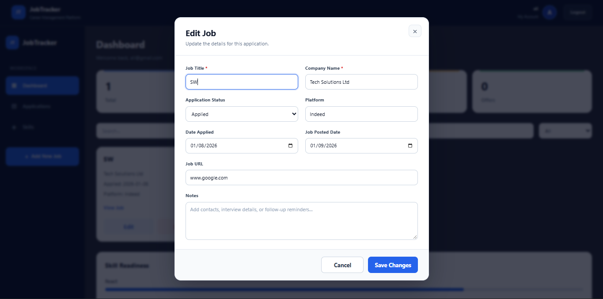
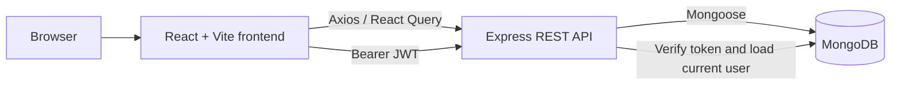

# JobTracker — Full-Stack Job Application Management System

[](https://react.dev/)
[](https://vite.dev/)
[](https://nodejs.org/)
[](https://expressjs.com/)
[](https://www.mongodb.com/)
[](https://developer.mozilla.org/docs/Web/JavaScript)
[](https://jwt.io/)
[](https://jestjs.io/)

JobTracker helps users organize job applications, track progress from application to offer, and keep dates, platforms, links, and notes in one focused workspace. It was built as a full-stack software engineering project with a responsive React interface, a secured Express API, MongoDB persistence, and automated backend security tests.

[Features](#features) · [Screenshots](#application-screenshots) · [Tech Stack](#tech-stack) · [Architecture](#architecture) · [Getting Started](#getting-started) · [API](#api-reference) · [Testing](#testing)

## Features

### Authentication

- User registration and login with server-side validation
- JWT-based authentication and protected frontend routes
- Session restoration through the authenticated `/api/auth/me` endpoint
- Password hashing with bcrypt
- Responsive login and registration forms with inline validation
- Branded full-screen, inline, and button loading states
- Database-backed authorization so current user roles are applied immediately

### Job management

- Create and edit job applications
- Soft-delete applications while preserving database records
- Track `applied`, `interview`, and `offer` stages with transition history
- Search titles and companies and filter by application status
- Store application dates, posting dates, platform names, job links, and notes
- User-scoped access controls that prevent cross-account reads and mutations

### Dashboard

- At-a-glance totals for all applications and each tracked status
- Responsive application cards with edit and delete controls
- Search and status-filter controls
- Skills progress panel
- Desktop, tablet, and mobile layouts
- Accessible Add/Edit Job modal with validation, keyboard controls, loading states, and API error feedback

### Backend engineering

- REST API built with Express and Mongoose
- Request validation and normalization with `express-validator`
- Explicit job-field allowlisting to prevent mass assignment
- Ownership checks on job reads, updates, and deletion
- Escaped search expressions and bounded pagination
- Centralized asynchronous error handling and safe JSON error responses
- Authentication rate limiting, Helmet security headers, request-size limits, and CORS allowlisting
- Environment validation, database-aware health checks, and graceful shutdown handling

### Testing

- Jest API tests against an isolated in-memory MongoDB instance
- Supertest coverage for authentication, authorization, admin routes, ownership, validation, status transitions, CORS, rate limiting, and protected-field injection
- No production database connection is made by the automated test suite

## Application Screenshots

### Dashboard

<p align="center">
  
</p>

<p align="center"><em>The responsive workspace brings application statistics, search and filtering, job cards, and career skills into one consolidated dashboard.</em></p>

### Login

<p align="center">
  
</p>

<p align="center"><em>The branded sign-in experience combines clear validation, password visibility controls, and responsive SaaS-style presentation.</em></p>

### Registration

<p align="center">
  
</p>

<p align="center"><em>The registration flow provides labelled account fields, password confirmation, inline validation, and guidance back to login.</em></p>

### Add Job

<p align="center">
  
</p>

<p align="center"><em>The Add New Job modal organizes application details in a focused, responsive form with client-side validation and accessible controls.</em></p>

### Edit Job

<p align="center">
  
</p>

<p align="center"><em>The edit workflow restores existing application data and supports reliable updates with mutation-aware loading and error feedback.</em></p>

## Tech stack

| Layer | Technologies |
|---|---|
| Frontend | React 19, Vite 7, JavaScript, React Router |
| UI styling | CSS Modules, global CSS |
| Backend | Node.js, Express 4 |
| Database | MongoDB, Mongoose |
| Authentication | JSON Web Tokens, bcryptjs |
| Data fetching | TanStack React Query, Axios |
| Validation | express-validator, custom client-side validation |
| Testing | Jest, Supertest, MongoDB Memory Server |
| Security | Helmet, Express Rate Limit, CORS, field allowlisting |
| Tooling | ESLint, Nodemon, npm |

## Architecture



The frontend uses React Router for public and protected navigation. Authentication tokens are stored using the existing client authentication context and attached to API requests by an Axios interceptor. The Express authentication middleware verifies each JWT and loads the current user from MongoDB before allowing protected operations. React Query manages job fetching, mutations, cache invalidation, and dashboard refreshes.

### Project structure

```text
job-tracker/
├── src/
│   ├── api/                 # Axios client and API functions
│   ├── auth/                # Auth context, hook, and route guards
│   ├── components/          # Navbar, sidebar, cards, modal, forms, loader
│   ├── hooks/               # React Query job hooks
│   ├── pages/               # Login, registration, and dashboard pages
│   ├── styles/              # Shared layout and authentication styles
│   └── utils/               # API-to-UI job adapter
├── server/
│   ├── src/
│   │   ├── config/          # Environment configuration
│   │   ├── middleware/      # Auth, validation, security, and errors
│   │   ├── models/          # User and Job Mongoose models
│   │   ├── routes/          # Auth, jobs, analytics, and admin APIs
│   │   ├── tests/           # Admin and security regression suites
│   │   ├── app.js           # Express application configuration
│   │   └── server.js        # Database connection and process lifecycle
│   └── .env.example
├── .env.example
└── README.md
```

## Getting started

### Requirements

- Node.js 20.19 or newer
- npm
- Git
- A local MongoDB instance or MongoDB Atlas connection

### 1. Clone the repository

```bash
git clone https://github.com/hamzaawan26/job-tracker-fullstack.git
cd job-tracker-fullstack
```

### 2. Install frontend dependencies

From the repository root:

```bash
npm install
```

### 3. Install backend dependencies

```bash
cd server
npm install
cd ..
```

### 4. Configure environment variables

Create local files from the committed examples. On macOS or Linux:

```bash
cp .env.example .env
cp server/.env.example server/.env
```

On Windows PowerShell:

```powershell
Copy-Item .env.example .env
Copy-Item server/.env.example server/.env
```

Frontend `.env`:

```dotenv
VITE_API_URL=http://localhost:4000/api
```

Backend `server/.env`:

```dotenv
NODE_ENV=development
PORT=4000
MONGO_URI=mongodb://127.0.0.1:27017/jobtracker
JWT_SECRET=replace-with-a-long-random-secret-at-least-32-characters
CORS_ORIGINS=http://localhost:5173,http://localhost:4173
```

Replace placeholder values locally. Never commit `.env` files or real credentials. Production mode requires a JWT secret of at least 32 characters and an explicit comma-separated CORS origin allowlist.

### 5. Start the backend

In one terminal:

```bash
cd server
npm run dev
```

The API defaults to `http://localhost:4000`.

### 6. Start the frontend

In a second terminal, from the repository root:

```bash
npm run dev
```

Vite normally serves the application at `http://localhost:5173`. Use the exact URL printed by Vite if that port is unavailable.

### Production build

```bash
npm run build
npm run preview
```

The repository does not currently include a deployment configuration or a public production URL.

## API reference

All endpoints are prefixed with `/api`. Protected requests require an `Authorization: Bearer <token>` header.

### System and authentication

| Method | Endpoint | Description | Access |
|---|---|---|---|
| `GET` | `/api/health` | Report API and database readiness | Public |
| `POST` | `/api/auth/register` | Create a standard user account | Public, rate-limited |
| `POST` | `/api/auth/login` | Authenticate and return a JWT | Public, rate-limited |
| `GET` | `/api/auth/me` | Restore the current authenticated user | Authenticated |

### Jobs

| Method | Endpoint | Description | Access |
|---|---|---|---|
| `GET` | `/api/jobs` | List the current user's jobs with search, filters, and pagination | Authenticated |
| `POST` | `/api/jobs` | Create a job application | Authenticated |
| `GET` | `/api/jobs/:id` | Retrieve one owned, active job | Authenticated |
| `PUT` | `/api/jobs/:id` | Replace supported details on an owned job | Authenticated |
| `PATCH` | `/api/jobs/:id` | Update supported details on an owned job | Authenticated |
| `DELETE` | `/api/jobs/:id` | Soft-delete an owned job | Authenticated |

Supported list query parameters are `page`, `limit`, `status`, `platform`, and `search`.

### Analytics

| Method | Endpoint | Description | Access |
|---|---|---|---|
| `GET` | `/api/analytics/summary` | Return total and status counts | Authenticated |
| `GET` | `/api/analytics/platforms` | Group applications by platform | Authenticated |
| `GET` | `/api/analytics/timeline` | Return monthly application activity | Authenticated |
| `GET` | `/api/analytics/overview` | Return dashboard status totals | Authenticated |
| `GET` | `/api/analytics/status-breakdown` | Return status/count records | Authenticated |
| `GET` | `/api/analytics/time-metrics` | Calculate average transition timing metrics | Authenticated |
| `GET` | `/api/analytics/funnel` | Return application-funnel counts and conversions | Authenticated |

### Administration

| Method | Endpoint | Description | Access |
|---|---|---|---|
| `GET` | `/api/admin/users` | List users without password hashes | Current admin role required |
| `GET` | `/api/admin/jobs` | List jobs with owner email information | Current admin role required |
| `GET` | `/api/admin/stats` | Return platform-wide user and active-job totals | Current admin role required |

The protected admin API exists, but an Admin Dashboard UI has not been implemented.

## Security

JobTracker applies defense-in-depth controls appropriate to the current project scope:

- Passwords are hashed with bcrypt before persistence.
- JWTs are verified with an explicit algorithm allowlist.
- Protected requests resolve the current user and role from the database.
- Job queries enforce ownership and exclude soft-deleted records.
- Create and update routes allowlist supported job fields, preventing protected-field assignment.
- `express-validator` validates and normalizes authentication, job, filter, pagination, URL, date, and ID inputs.
- Search text is length-limited and escaped before use in regular expressions.
- Login and registration endpoints are rate-limited.
- Helmet adds common HTTP security headers.
- CORS uses an environment-configured origin allowlist without unnecessary credential support.
- Request bodies are size-limited and unexpected errors receive sanitized responses.
- Production startup validates required environment configuration.

These controls improve the application's security posture but do not constitute an independent security audit. The current rate limiter uses process memory; a shared store such as Redis should be configured before scaling the API across multiple instances.

## Testing

Run the complete backend suite from `server/`:

```bash
cd server
npm test
```

The current suite contains **20 passing backend tests**:

- **9 admin and model tests** covering authentication requirements, admin authorization, protected user/job data, statistics, and role validation.
- **11 security regression tests** covering missing, invalid, and expired JWTs; role revocation; public registration restrictions; ownership isolation; mass-assignment protection; malformed IDs and pagination; escaped searches; status history; CORS; safe malformed-body responses; and rate limiting.

Tests use Supertest and MongoDB Memory Server, so they do not connect to the production database.

Additional repository checks:

```bash
# From the repository root
npm run lint
npm run build
```

Frontend unit and end-to-end test suites have not yet been added.

## Project status and roadmap

JobTracker is a developed full-stack project currently undergoing final portfolio preparation.

### Implemented

- Responsive frontend and dashboard
- Authentication and session restoration
- User-scoped job management and analytics APIs
- Backend security hardening
- Automated backend admin and security tests
- Local build and test validation

### Planned

- Public deployment
- Additional analytics and visualizations
- Broader frontend and end-to-end test coverage
- Optional Admin Dashboard interface

Planned items are not part of the current implementation.

## Developer

**Developed by Hamza Awan**<br>
Software Engineer | Full-Stack Developer

- [GitHub](https://github.com/hamzaawan26)
- [LinkedIn](https://www.linkedin.com/in/hamza-awan-70b356206/)
